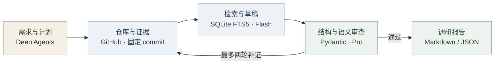

<h1 align="center">RepoScout</h1>

<p align="center"><strong>开源项目调研 Agent</strong></p>

<p align="center">
  使用自然语言搜索公开 GitHub 仓库，阅读固定 commit 的资料与源码，<br/>
  生成附带证据来源的 Markdown / JSON 技术选型报告。
</p>

<p align="center">
  <code>Python 3.12</code> · <code>Deep Agents</code> · <code>DeepSeek Flash / V4 Pro</code> · <code>SQLite FTS5</code>
</p>

<p align="center">
  <a href="#快速开始">快速开始</a> &nbsp;·&nbsp;
  <a href="#运行示例">运行示例</a> &nbsp;·&nbsp;
  <a href="docs/DESIGN.md">设计与架构</a> &nbsp;·&nbsp;
  <a href="docs/EVALUATION.md">评测记录</a>
</p>

---

## 项目概览

技术选型需要反复搜索仓库、检查依赖、核对维护状态。RepoScout 将这些操作组织成可恢复的调研任务，保留每项条件判定的证据，方便复核和再次调研。

| 调研环节 | 项目能力 |
| :--- | :--- |
| **定位资料** | 搜索公开仓库，浏览指定目录，按文件名定位 README、依赖与关键源码。 |
| **检索证据** | 固定仓库 commit，对已采集文本分块检索，保留路径、原始行号和读取时间。 |
| **比较与核验** | Flash 形成草稿，Pro 独立审查引用原文，按问题定向补证，保留未知项。 |
| **保存与恢复** | SQLite 持久化任务、证据与预算，支持取消、恢复和双格式报告导出。 |

任务编排和上下文管理复用 Deep Agents。GitHub 专用工具、commit 固定、全文检索、证据关联、双模型辅助核验、任务恢复、预算账本与评测属于本项目的开发内容。详细来源见 [上游与贡献说明](docs/UPSTREAM.md)。

## 快速开始

在 macOS 或 Linux 准备 Python 3.12 和 uv，安装依赖并创建本地配置。 [uv 安装说明](https://docs.astral.sh/uv/)

```bash
git clone https://github.com/carefreelove/RepoScout.git
cd RepoScout
uv sync --frozen
cp .env.example .env
```

在 `.env` 填写 `DEEPSEEK_API_KEY`，可选填写 `GITHUB_TOKEN` 以提高 GitHub API 配额。`.env` 已被 Git 忽略。

```bash
uv run reposcout research \
  "搜索 Java Agent 框架，比较 langchain4j/langchain4j 与 alibaba/spring-ai-alibaba，给出技术栈和使用方式的证据。"
```

终端会输出任务 ID 与报告路径。查看结果或恢复任务时，使用同一 ID。

```bash
uv run reposcout show <run-id>
uv run reposcout resume <run-id>
```

每次任务保存以下文件。

```text
.reposcout/runs/<run-id>/
├── report.md
├── report.json
├── review.json
└── events.jsonl
```

`Ctrl+C` 取消并保存任务。恢复沿用原任务的调用次数、时间及费用限额。通过 `REPOSCOUT_HOME` 指定数据目录，跨目录操作时应指向同一个绝对路径。

<details>
<summary><strong>模型与环境配置</strong></summary>

模型采用 `deepseek-flash`、`deepseek-v4-pro` 与 `https://api.deepseek.com/anthropic`。接受 `DEEPSEEK_API_KEY`、`ANTHROPIC_API_KEY` 或现有 `ANTHROPIC_AUTH_TOKEN`。本地其他工具的带后缀模型名由项目独立配置转换。

技术栈为 Python 3.12、Deep Agents 0.7.35、DeepSeek Flash / V4 Pro、GitHub REST API、SQLite FTS5 与 Typer。

</details>

## 运行示例

以下报告来自已保存的真实运行，包含引用来源、条件判定、未知项与执行统计。

| 场景 | 查看报告 |
| :--- | :--- |
| 技术栈选型 | [Java Agent 框架的依赖与源码依据](examples/v0.2/live/stack/report.md) |
| 候选比较 | [LangChain4j 与 Spring AI Alibaba](examples/v0.2/live/comparison/report.md) |
| 证据不足 | [单机 1 万 QPS 条件保留为未确认](examples/v0.2/live/insufficient/report.md) |
| 定向补证 | [受控错误经审查、检索与修正的完整记录](examples/v0.2/repair-demo/report.md) |

补证案例向初始草稿刻意注入 Java 8 错误，使用真实 GitHub 资料和真实 Flash / Pro，最终通过父 POM 证据修正为 Java 17。更多运行结果见 [示例目录](examples/v0.2/)。

---

## 工作流程



SQLite 保存任务状态、资料缓存与执行位置，统一模型预算适配器计量调研、压缩和核验调用。

条件使用 **满足 / 不满足 / 未确认**。报告区分文档声明、源码依据和未知事项。每条证据包含 commit、路径、行号、来源 URL、读取时间及截断标记。

### 仓库资料检索

成功读取的文件全文按仓库、commit 和路径建索引，文件大小限额为 256 KB。每个分块最多 80 行、8 KB，相邻块最多重叠 10 行。检索使用 FTS5/BM25，并以参数化子串匹配覆盖短中文词和代码标识符片段，默认前 5 个命中总文本至多 16 KB。

Agent 可浏览指定目录、匹配文件名，搜索已采集资料，并用 `get_evidence` 取回当前任务的原文。跨任务复用的文本始终匹配固定 commit，元数据与维护记录按任务重新采集。检索零命中会保留索引范围说明。

### 双模型辅助核验

Flash 负责调研，Pro 以独立上下文审查草稿与引用原文，覆盖事实、条件判定、摘要、推荐理由与结论。结果为 **有依据 / 依据不足 / 存在矛盾**。初审之后最多进行两轮定向补证，无进展时停止。

报告 schema 为 `1.1`，读取器兼容已有 `1.0` 报告。新任务完成须同时通过结构校验与 Pro 辅助核验，服务失败或限额耗尽会导出 `partial` 报告及核验记录。模型辅助核验的判断需要结合原文复核。

## 运行边界与预算

| 项目 | 默认值 |
| :--- | :--- |
| 搜索候选数 | 10，可用 `--search-limit` 调整 |
| 深入分析仓库数 | 3，可用 `--analyze-limit` 调整 |
| 每任务模型调用 | 20，包含 Flash、Pro、压缩、修复和重试 |
| 每任务 GitHub 请求 | 60，重试同样计数 |
| 每任务累计运行时间 | 600 秒，恢复延续累计时间 |
| 同一数据目录累计模型费用上限 | 人民币 20 元 |
| 文件读取范围 | 每次至多 200 行、24 KB 内容，文件总大小至多 256 KB |

当前处理公开仓库。Agent 文件工具使用 StateBackend，默认子 Agent 与 shell 工具已关闭。仓库资料作为待分析数据处理，目标项目的功能运行效果保留为未确认。

<details>
<summary><strong>费用预留、用量异常与恢复</strong></summary>

价格快照采用 2026-11-12 官方高峰价格。Flash 输入 2 元、输出 8 元/百万 tokens，Pro 输入 9 元、输出 27 元/百万 tokens。全部输入按未命中缓存估算，账本记录模型、角色和费率，账单以服务商为准。更新价格时需同步更新配置。 [官方价格](https://api-docs.deepseek.com/zh-cn/quick_start/pricing/)

调用前原子预留费用，收到 usage 后结算。连接中断或缺少 usage 时保留预留费用并暂停新的付费调用。同一数据目录的付费请求串行执行。保持同一数据目录，才能延续累计预算。

需要继续处理未知用量时，可由操作者明确接受完整最高预留额，使用异常中显示的记录 ID 执行以下命令。费用上界与未知标记持续保留，后续调用继续受累计上限约束。

```bash
uv run reposcout acknowledge-usage <ticket>
```

`statistics` 中 `usage_complete=false` 表示仍有未确认用量，token 合计仅包括已返回 usage 的调用。报告中的费用包含已接受的最高预留额。

</details>

## 测试与评测

```bash
uv run pytest -q
uv run ruff check src tests
uv run reposcout evaluate --suite smoke
uv run reposcout evaluate --suite evidence
```

默认评测使用合成 HTTP 响应与脚本模型，经过真实 Deep Agents 图，验证流程与故障行为。evidence 问题集包含固定中英文检索语料和核验负例。

<details>
<summary><strong>运行真实模型评测 · 会产生 API 费用</strong></summary>

```bash
uv run reposcout evaluate --suite smoke --live
uv run reposcout evaluate --suite evidence --live
```

smoke 的 `--live` 模式调用真实模型和 GitHub，并为每条问题额外运行一次同模型单次回答对照。对照模型只接收原始问题，信息访问条件随结果记录。

evidence 的 `--live` 模式用真实 Pro 审查合成证据，记录标签命中情况。

</details>

事实和条件正确性需要人工核验，引用完整性由程序检查。真实运行数据、失败记录与评测条件见 [评测记录](docs/EVALUATION.md)。

---

## 项目文档

- [设计与架构](docs/DESIGN.md) 记录问题背景、选择依据、方案取舍、实现步骤和验证结果。
- [上游与贡献](docs/UPSTREAM.md) 说明 Deep Agents 复用范围与项目改造内容。
- [第三方声明](THIRD_PARTY_NOTICES.md) 记录上游引用与演示证据的许可。

## License

MIT。
