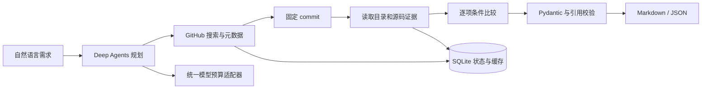

# RepoScout｜开源项目调研 Agent

使用自然语言搜索公开 GitHub 仓库，读取固定 commit 的资料与关键源码，生成附带来源的 Markdown / JSON 技术选型报告。

Python 3.12 · Deep Agents 0.7.35 · DeepSeek · GitHub REST API · SQLite · Typer

## 为什么做

技术选型需要反复搜索仓库、检查依赖、核对维护状态。RepoScout 将这些操作组织成可恢复的调研任务，保留每项条件判定的证据，方便复核和再次调研。

开发内容包括 GitHub 专用工具、commit 固定、证据关联、报告校验、任务恢复、预算账本及评测。任务编排和上下文管理复用 Deep Agents。详细来源见 [上游与贡献说明](docs/UPSTREAM.md)。

## 快速开始

准备 Python 3.12 和 [uv](https://docs.astral.sh/uv/)，执行以下命令。

```bash
git clone https://github.com/carefreelove/RepoScout.git
cd RepoScout
uv sync --frozen
cp .env.example .env
```

在本地 `.env` 填写 `DEEPSEEK_API_KEY`，可选填写 `GITHUB_TOKEN` 以提高 GitHub API 配额。`.env` 已被 Git 忽略。

```bash
uv run reposcout research "搜索 Java Agent 框架，比较 langchain4j/langchain4j 与 spring-ai-alibaba/spring-ai-alibaba，给出技术栈和使用方式的证据。"
uv run reposcout show <run-id>
uv run reposcout resume <run-id>
```

终端输出任务 ID 与报告路径。每次任务保存以下文件。

```text
.reposcout/runs/<run-id>/
  report.md
  report.json
  events.jsonl
```

`Ctrl+C` 取消并保存任务。恢复沿用原任务的调用次数、时间及费用限额。通过 `REPOSCOUT_HOME` 指定数据目录，跨目录操作时应指向同一个绝对路径。

## 工作流程



条件使用“满足 / 不满足 / 未确认”。报告区分文档声明、源码依据和未知事项。证据包含 commit、路径、行号、来源 URL、读取时间及截断标记。

## 默认限制

| 项目 | 默认值 |
| --- | --- |
| 搜索候选数 | 10，可用 `--search-limit` 调整 |
| 深入分析仓库数 | 3，可用 `--analyze-limit` 调整 |
| 每任务模型调用 | 20，包含压缩和修复调用 |
| 每任务 GitHub 请求 | 60，重试同样计数 |
| 每任务累计运行时间 | 600 秒，恢复延续累计时间 |
| 同一数据目录累计模型费用上限 | 人民币 20 元 |
| 文件读取范围 | 每次至多 200 行、24 KB 内容，文件总大小至多 256 KB |

价格快照采用 2026-11-12 官方 Flash 高峰价格，输入 2 元/百万 tokens，输出 8 元/百万 tokens，所有输入按未命中缓存估算。记录的是保守费用估算，账单以服务商为准。更新价格时需同步更新配置。 [官方价格](https://api-docs.deepseek.com/zh-cn/quick_start/pricing/)

调用前原子预留费用，收到 usage 后结算。连接中断或缺少 usage 时保留预留费用并暂停新的付费调用。同一数据目录的付费请求串行执行。保持同一数据目录，才能延续累计预算。

模型采用 `deepseek-flash` 与 `https://api.deepseek.com/anthropic`。接受 `DEEPSEEK_API_KEY`、`ANTHROPIC_API_KEY` 或现有 `ANTHROPIC_AUTH_TOKEN`。本地其他工具的带后缀模型名由项目独立配置转换。

## 测试与评测

```bash
uv run pytest -q
uv run ruff check src tests
uv run reposcout evaluate --suite smoke
uv run reposcout evaluate --suite smoke --live
```

默认评测使用合成 HTTP 响应与脚本模型，经过真实 Deep Agents 图，验证流程与故障行为。`--live` 调用真实模型和 GitHub，并为每条问题额外运行一次同模型单次回答对照，会产生 API 费用。

真实演示见 [examples](examples/)，结果见 [评测记录](docs/EVALUATION.md)。事实和条件正确性需要人工核验，引用完整性由程序检查。对照模型只接收原始问题，信息访问条件随结果记录。

## 技术文档

- [设计与架构](docs/DESIGN.md) 记录问题背景、选择依据、方案取舍、实现步骤和验证结果。
- [上游与贡献](docs/UPSTREAM.md) 说明复用与改造内容。

当前处理公开仓库。Agent 文件工具使用 StateBackend，默认子 Agent 与 shell 工具已关闭。仓库资料作为待分析数据处理，目标项目的功能运行效果保留为未确认。

## License

MIT。上游引用与演示证据的许可见 [第三方声明](THIRD_PARTY_NOTICES.md)。
